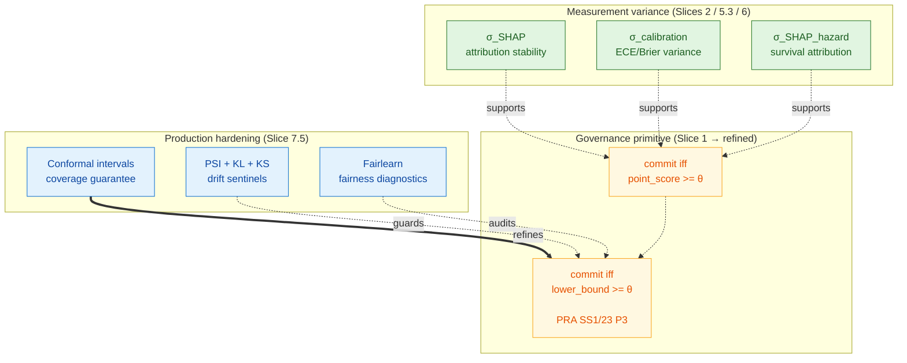

# Slice 7.5 architecture diagram

ASCII + Mermaid pair for the production hardening slice. Drop into
`docs/architecture.md` under §8 if you want an inline diagram, or
publish separately as `docs/figures/slice_7_5.png` after rendering
the Mermaid.

---

## ASCII — scoring path with hardening pipeline

```
                     ┌────────────────────────────────┐
                     │  LeadInput                     │
                     │  + protected_attributes: dict  │   ← Slice 7.5 schema
                     │  + 30 LeadForge features       │
                     └────────────────┬───────────────┘
                                      │
                                      ▼
            ┌──────────────────────────────────────────────┐
            │     ScoringAgent  (agents/scoring_agent.py)  │
            └──────────────────────┬───────────────────────┘
                                   │
            ┌──────────────────────┼──────────────────────┐
            │                      │                      │
            ▼                      ▼                      ▼
   ┌──────────────┐    ┌──────────────────┐    ┌───────────────────┐
   │  pre-check   │    │  conformal score │    │  (batch handoff)  │
   │  drift       │    │                  │    │  fairness audit   │
   │              │    │  (point, lo, up) │    │                   │
   │  PSI+KL+KS   │    │  + conservative  │    │  Fairlearn        │
   │  Slice 7.5b  │    │  commit flag     │    │  Slice 7.5c       │
   │              │    │  Slice 7.5a      │    │                   │
   └──────┬───────┘    └────────┬─────────┘    └─────────┬─────────┘
          │                     │                        │
          ▼                     ▼                        ▼
   ┌─────────────────────────────────────────────────────────────┐
   │       ProductionHardeningPipeline  (pinkmate/ml/)           │
   │                                                             │
   │    conformal.py   +  drift.py  +  fairness.py               │
   │         │                │              │                   │
   │         └────> MAPIE ────┘              └────> Fairlearn     │
   │                                                             │
   └─────────────────────────────────────────────────────────────┘
                                   │
                                   ▼
                     ┌────────────────────────────────┐
                     │  ScoringOutput                 │
                     │  + conformal_lower             │   ← Slice 7.5 schema
                     │  + conformal_upper             │
                     │  + drift_flags: list[str]      │
                     │  + is_committed_at_theta       │
                     │  (conservative, not point)     │
                     └────────────────────────────────┘
                                   │
                                   ▼
                     ┌────────────────────────────────┐
                     │  Agent trace  (SQLite)         │
                     │  + fairness_reports            │
                     │  + drift_results (batch)       │
                     └────────────────────────────────┘
```

---

## Mermaid — three-way sibling diagram

Positions the production-hardening trio alongside the
measurement-variance trio (σ_SHAP, σ_calibration, σ_SHAP_hazard)
already in the architecture.



---

## Reading guide

The two diagrams tell complementary stories:

* **ASCII** shows the **control flow** at inference time: where each
  check fires, what data it consumes, what it attaches to the trace.
* **Mermaid** shows the **architectural positioning**: Slice 7.5's
  three modules are siblings of the existing σ_* measurement trio,
  and they refine (not replace) the Slice 1 governance primitive.

The ASCII diagram is version-control-friendly (text diff). The
Mermaid rendering is better for the paper figures and the README
hero. Both are kept in sync by hand when the architecture evolves.
