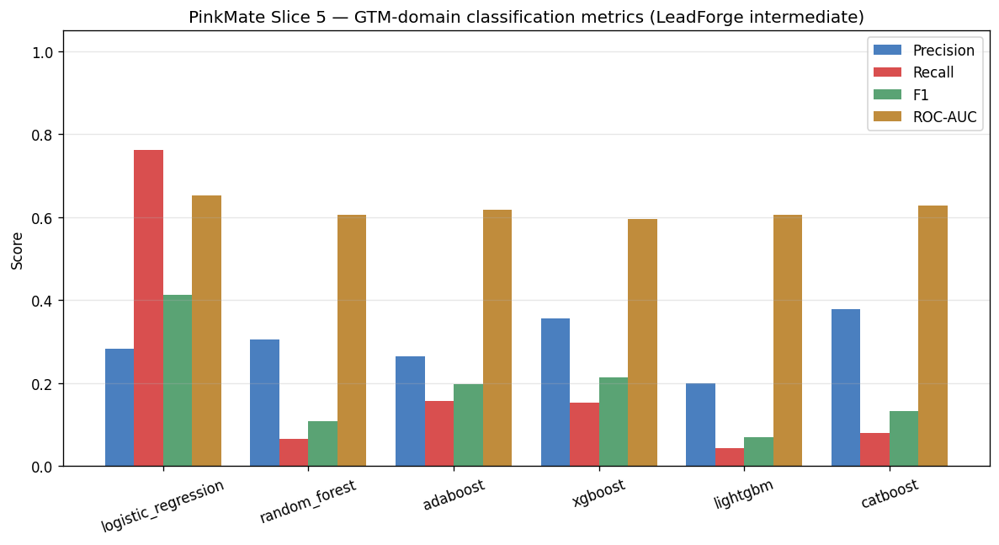
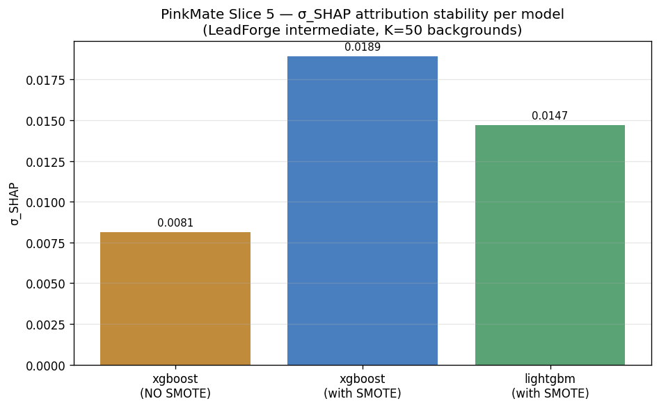

# PinkMate Slice 5 — GTM-Domain Training Report

- **Generated**: 2026-11-08T07:10:20Z
- **Dataset**: LeadForge Lead Scoring v1 — tier `intermediate`
- **Source**: `cached`
- **Rows loaded**: 2 classes; test-partition size fixed by seed=42 split
- **Minority rate (converted_within_90_days)**: 0.2098
- **Seed**: 42
- **Dataset SHA-256**: `f19d91c70ea8ac271c5823d78c1fa9161b30abde4704806c9b5754c5a3993334`

---

## Methodology validation on synthetic B2B-shaped data

The σ_SHAP numbers below and the PNG charts under
`docs/figures/gtm/` are the output of applying the Q-MDP
σ_SHAP governance harness to B2B-shaped tabular data for
the first time. **They DO NOT constitute performance claims**
**about PinkMate on real B2B GTM leads.** Real-data validation
is deferred to Slice 5.1+ once a labelled real corpus is
available.

This honesty bar mirrors Slice 2's Taiwan Bankruptcy framing —
the paper validates the framework on a declared benchmark, it
does not claim the trained models should be used for other
domains without retraining.

---

## 1. Classification metrics (held-out test partition)

| Model | Precision | Recall | F1 | ROC-AUC |
|-------|-----------|--------|-----|---------|
| logistic_regression | 0.2837 | 0.7619 | 0.4134 | 0.6532 |
| random_forest | 0.3043 | 0.0667 | 0.1094 | 0.6059 |
| adaboost | 0.2640 | 0.1571 | 0.1970 | 0.6185 |
| xgboost | 0.3556 | 0.1524 | 0.2133 | 0.5956 |
| lightgbm | 0.2000 | 0.0429 | 0.0706 | 0.6048 |
| catboost | 0.3778 | 0.0810 | 0.1333 | 0.6288 |



---

## 2. Attribution stability — σ_SHAP (paper §V)

| Model | Training regime | σ_SHAP | mean &#124;φ&#124; | K backgrounds | Background size | N reference |
|-------|-----------------|--------|-------------------|---------------|-----------------|-------------|
| xgboost | with SMOTE | 0.0189 | 0.1081 | 50 | 100 | 200 |
| lightgbm | with SMOTE | 0.0147 | 0.0653 | 50 | 100 | 200 |
| xgboost | **without SMOTE (baseline)** | 0.0081 | 0.0905 | 50 | 100 | 200 |



---

## 3. Qualitative-direction verdict (vs Taiwan Slice 2)

Per Phase 1 Critique 3 (close-out of Slice 5 scope planning), the
verdict on LeadForge is **qualitative-direction**, not
magnitude-tolerance. Taiwan Slice 2's two §VI.C qualitative
observations are tested for transferability:

**SMOTE direction on XGBoost (Taiwan expected: INCREASE)**
→ PASS — SMOTE increases σ_SHAP on XGBoost (0.0081 → 0.0189, Δ=+0.0108)

**Model stability ordering (Taiwan expected: LightGBM < XGBoost)**
→ PASS — LightGBM σ_SHAP < XGBoost σ_SHAP (0.0147 < 0.0189)

DRIFT verdicts on LeadForge are **expected possible outcomes**,
not failures — LeadForge's ~20% minority class is less imbalanced
than Taiwan's 3.23%, so SMOTE's effect on σ_SHAP has less
headroom to move in the same direction with the same magnitude.

---

## 4. Reproducing

```bash
python scripts/train_gtm_ensemble.py             # Full K=50 run (~10 min)
python scripts/train_gtm_ensemble.py --fast      # K=10 quick check (~2 min)
python scripts/train_gtm_ensemble.py --synthetic # Hermetic synthetic run
python scripts/train_gtm_ensemble.py --tier advanced  # Slice 5.1 preview
```

Trained pickles land under `models/gtm/`. The ScoringAgent default
(`model_source="zoo"`, `models_dir="models/gtm"`) picks them up
automatically on next construction.
