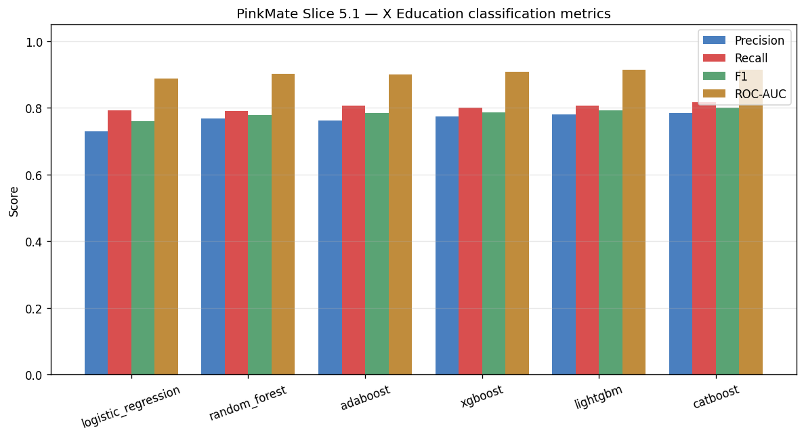
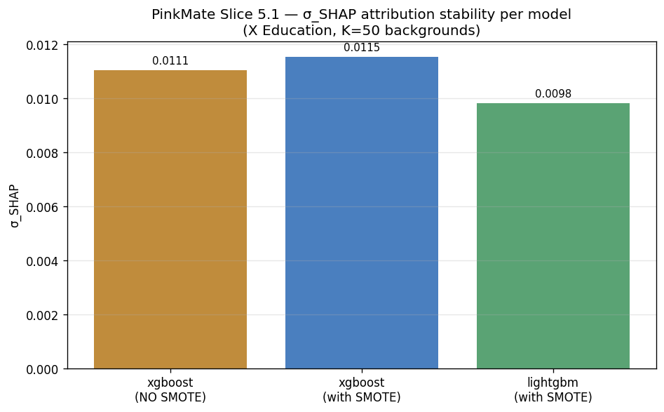

# PinkMate Slice 5.1 — X Education Training Report

- **Generated**: 2026-11-09T10:57:04Z
- **Dataset**: X Education Lead Scoring (Zenodo 23791277, CC BY 4.0)
- **Source**: `cached`
- **Minority rate (Converted=1)**: 0.3854
- **Seed**: 42
- **Dataset SHA-256**: `72576093918d8bc241e11ce9d020b2133f5e3dd0592709bd65059fa91b1ab58e`
- **Leakage columns excluded**: Tags, Lead Quality, Lead Profile, Last Notable Activity
- **Near-zero-variance columns excluded**: Magazine, Receive More Updates About Our Courses, Update me on Supply Chain Content, Get updates on DM Content, I agree to pay the amount through cheque

---

## Methodology validation on real EdTech lead-scoring data

X Education is real labelled EdTech B2B lead-scoring data
(~38.54% conversion), mirrored from Kaggle to Zenodo under
CC BY 4.0 (Aqil & Halim 2026). The Tags column — known to
drive 0.98+ AUC inflation via sales-team post-hoc labels —
is excluded along with Lead Quality, Lead Profile, and Last
Notable Activity as defensive leakage-trap exclusions.

Expected AUC range after leakage exclusion: **0.70-0.85**.
Any model exceeding 0.95 fails the methodology-integrity test.

**The σ_SHAP numbers below DO NOT constitute performance**
**claims about PinkMate on real target-industry B2B GTM leads.**
X Education is an EdTech lead-scoring dataset; real-data
validation on a target-industry corpus remains deferred to
later data-gated work.

---

## 1. Classification metrics (held-out test partition)

| Model | Precision | Recall | F1 | ROC-AUC |
|-------|-----------|--------|-----|---------|
| logistic_regression | 0.7296 | 0.7921 | 0.7596 | 0.8875 |
| random_forest | 0.7670 | 0.7907 | 0.7787 | 0.9016 |
| adaboost | 0.7623 | 0.8062 | 0.7836 | 0.9009 |
| xgboost | 0.7734 | 0.8006 | 0.7867 | 0.9081 |
| lightgbm | 0.7799 | 0.8062 | 0.7928 | 0.9142 |
| catboost | 0.7844 | 0.8174 | 0.8006 | 0.9151 |



---

## 2. Attribution stability — σ_SHAP (paper §V)

| Model | Training regime | σ_SHAP | mean &#124;φ&#124; | K backgrounds | Background size | N reference |
|-------|-----------------|--------|-------------------|---------------|-----------------|-------------|
| xgboost | with SMOTE | 0.0115 | 0.0521 | 50 | 100 | 200 |
| lightgbm | with SMOTE | 0.0098 | 0.0394 | 50 | 100 | 200 |
| xgboost | **without SMOTE (baseline)** | 0.0111 | 0.0509 | 50 | 100 | 200 |



---

## 3. Qualitative-direction verdict (vs Taiwan + LeadForge)

**SMOTE direction on XGBoost (Taiwan expected: INCREASE)**
→ PASS — SMOTE increases σ_SHAP on XGBoost (0.0111 → 0.0115, Δ=+0.0005)

**Model stability ordering (Taiwan expected: LightGBM < XGBoost)**
→ PASS — LightGBM σ_SHAP < XGBoost σ_SHAP (0.0098 < 0.0115)

**Methodological context:**
X Education at 38.54% minority sits at the near-balanced end of
the imbalance spectrum. The paper's §VI.C SMOTE-direction
observation is methodologically expected to WEAKEN at near-
balanced classes because SMOTE has less synthetic-positive
headroom to destabilize attribution. A DRIFT here is a nuanced
methodological-boundary finding, consistent with the paper's
definition. The model-stability ordering is architectural and
expected PASS regardless of imbalance.

---

## 4. Cross-dataset context (new in Slice 5.1)

| Dataset | Minority | Domain | Source | smote_direction | model_stability_ordering |
|---------|----------|--------|--------|-----------------|--------------------------|
| Taiwan Bankruptcy | 3.23% | Financial distress | Real (UCI) | PASS (paper §VI.C) | PASS (paper §VI.C) |
| LeadForge intermediate | 20.98% | B2B GTM | Synthetic (HF) | PASS (Slice 5, 42267e5) | PASS (Slice 5, 42267e5) |
| X Education | 38.54% | EdTech lead scoring | Real (Zenodo) | PASS (Slice 5.1) | PASS (Slice 5.1) |

---

## 5. Reproducing

```bash
python scripts/train_xeducation_ensemble.py             # Full K=50 run (~5 min)
python scripts/train_xeducation_ensemble.py --fast      # K=10 quick check (~2 min)
python scripts/train_xeducation_ensemble.py --synthetic # Hermetic synthetic run
```

Trained pickles land under `models/xeducation/`. The ScoringAgent
does NOT pick these up by default (ScoringAgent still defaults to
`models/gtm/`); X Education models are a research artefact, not a
deployment target.
